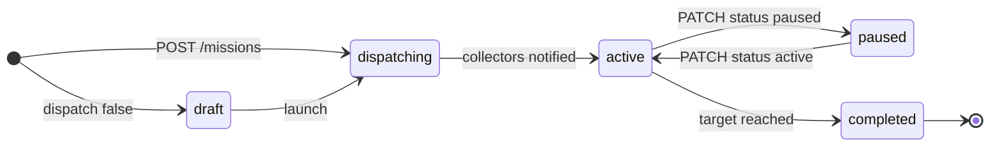

A **mission** is one data-collection project with a single goal, like *Household laundry folding*. It contains **tasks**, the distinct clips collectors record:

```json
{
  "id": "MSN-1042",
  "name": "Household laundry folding",
  "status": "active",
  "regions": ["US", "PT", "MX"],
  "target": 10000,
  "accepted": 7339,
  "tasks": [
    { "id": "T-2", "name": "Fold t-shirt", "videos": 2200, "duration": [20, 45], "price": 3.19 },
    { "id": "T-4", "name": "Fold towel",   "videos": 1900, "duration": [15, 35], "price": 2.78 }
  ]
}
```

Each task has:

- **`videos`**: how many *accepted* videos you want. Capibo keeps collecting until the task reaches that number, so you never pay for rejected clips at the task price.
- **`duration`**: the target clip length in seconds. Longer clips cost more per video.
- **`instructions`** and **`labels`**: what collectors see in the app and what's written into each video's annotations. Capibo generates both from the task name if you leave them out.

## Lifecycle



| Status | Meaning |
| --- | --- |
| `draft` | Created with `"dispatch": false`. Nothing is sent to collectors yet. |
| `dispatching` | Capibo is generating recording guidelines, localizing them and matching collectors. This usually takes a few minutes. |
| `active` | Collectors are recording, and videos are flowing through quality review. |
| `paused` | No new tasks reach collectors. Videos already recorded still finish review and are billed if accepted. |
| `completed` | Every task reached its target. A `mission.completed` webhook fires. |

## Planning with the estimate endpoint

[`POST /missions/estimate`](/api-reference/planning/estimate-a-mission) returns the price before you commit. It's the same estimate the planner shows in the platform:

- a **subtotal per task**: videos × price per video
- **QA processing**: $0.15 × the expected number of submissions, based on the acceptance rate of similar missions (usually 80–90%)
- the **collector pool** and the **estimated delivery time** in days
- **`balance_covers`**, whether your current credit balance covers the total

`POST /missions` returns `402 insufficient_credits` if the estimated total exceeds your balance. Add credits or redeem a promo code first. See [Credits and billing](/concepts/billing).

## Regions

Missions collect only in the regions you list, using ISO country codes (`UK` for the United Kingdom). More regions usually means faster delivery and more diverse environments: different kitchens, lighting and objects. That diversity tends to help policies generalize.
